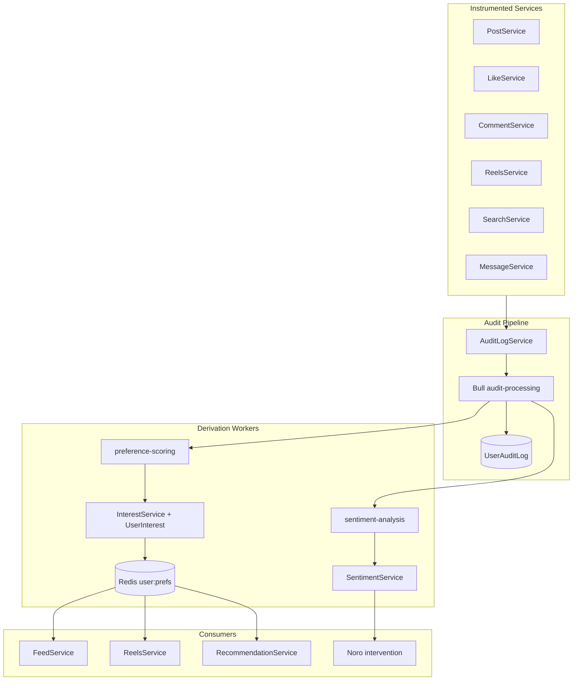

# Audit Merge & Personalization — Execution Plan

> **Supersedes** [audit_logs_&_personalization](../.cursor/plans/audit_logs_&_personalization_72a390e2.plan.md) for implementation details.  
> **Architecture decision:** Bridge audit logs → existing `UserInterest` (no `Tag` / `ContentTag` / `UserTagPreference`).

---

## Problem Statement

Branch `feature/sprint22-sentiment-mood-engine` is mid-merge with audit commit `e3bf769`. The merge left the repo in a **broken state**:

- 5 critical files deleted from disk but still staged
- `UserAuditLog` migration exists but `schema.prisma` is missing models
- `user-insights/` module is a skeleton importing non-existent files

Sprint22 already implements sentiment, interest scoring, and feed boosts via a simpler stack than the original 7-phase design.

---

## Target Architecture



---

## Phase 0 — Fix Merge (Blocker)

| Step | Action |
|------|--------|
| 0.1 | `git restore --source=:0 --worktree` for `redis.service.ts`, `auth.service.ts`, `search.service.ts`, `search.controller.ts`, `profile.service.ts` |
| 0.2 | Add `AuditAction` enum + `UserAuditLog` model + `User.auditLogs` to `prisma/schema.prisma` (from `MERGE_HEAD`) |
| 0.3 | Delete `.merge-head-search.service.ts`, `.merge-incoming-search.service.ts`, `_tmp_search_*.ts` |
| 0.4 | `pnpm prisma generate` + verify TypeScript build |
| 0.5 | Conclude merge commit |

---

## Phase 1 — Audit Fan-Out

**Files:** `audit.processor.ts`, `audit.module.ts`, `sentiment-analysis.processor.ts`, new `interest/preference.processor.ts`

After `userAuditLog.create`:

1. If `textSnapshot` → enqueue `analyze-audit-text` on `sentiment-analysis`
2. Always enqueue `score-audit-event` on `preference-scoring`

**Preference weights:**

| AuditAction | Points | Condition |
|-------------|--------|-----------|
| POST_VIEW, REEL_VIEW | +1 | `metadata.watchPct >= 50` |
| POST_LIKE, REEL_LIKE | +3 | — |
| COMMENT_CREATE | +5 | — |
| POST_CREATE | +4 | — |
| SEARCH_QUERY | +2 | query tokens match content hashtags/categories |
| POST_SAVE | +4 | — |
| POST_UNLIKE | -2 | — |

Tags resolved from `Post.hashtags`, `Reel.hashtags`, `categories` via `targetId` lookup.

---

## Phase 2 — Preferences (UserInterest Bridge)

**Extend** `interest.service.ts`:

- `applyAuditScore(userId, topics, basePoints, eventDate)` with decay `base * exp(-0.05 * days)`
- `cacheTopInterests(userId)` → Redis `ZADD user:prefs:{userId}`
- `getCachedTopInterests(userId, limit)` for feed/reels

**API:** `GET /interest/preferences` (top topics + scores)

**Update:** `feed.service.ts`, `reels.service.ts` — Redis cache first, DB fallback

---

## Phase 3 — Sentiment Bridge

**Extend** `sentiment.service.ts`:

- `analyzeAuditText(auditLogId, userId, text, action)` using existing keyword tokenizer
- Consolidate 70% threshold + cooldown into `checkAndTriggerIntervention()` (remove duplicate `user-insights/emotion-action.service.ts`)

**Schema:** add `UserEmotionAction` for action audit trail

**Deferred:** Transformers.js / `AuditSentiment` table (Phase 4c from original plan)

---

## Phase 4 — Recommendations

**New:** `interest/recommendation.service.ts` + controller

`GET /recommendations/for-you?type=POST|REEL|ALL`

```
finalScore =
  0.30 * graphScore
+ 0.35 * interestOverlap   // from Redis prefs
+ 0.20 * engagementScore
+ 0.10 * recencyScore
+ 0.05 * moodBoost
```

Optional: `RecommendationWarmupService` cron → Redis `user:recs:{userId}:{type}`

---

## Phase 5 — Admin APIs

**New:** `audit/audit.controller.ts`

| Endpoint | Purpose |
|----------|---------|
| `GET /admin/audit-logs` | Paginated `UserAuditLog` (admin guard) |
| `GET /admin/users/:id/insights` | Interests + sentiment + recent audits |

---

## Phase 6 — Cleanup

- Delete `src/modules/user-insights/` skeleton
- Remove merge temp files
- Mark original plan `tag-system` todo as **cancelled** (superseded by UserInterest bridge)
- Later: remove duplicate `recordInterest()` calls from post/reels once audit path is verified

---

## Mapping to Original Plan Todos

| Original todo | Execution status |
|---------------|------------------|
| audit-schema | ~80% done — finish schema sync + fan-out + search restore |
| tag-system | **Cancelled** — use UserInterest + hashtags |
| preference-scoring | Replaced by preference-bridge |
| sentiment-pipeline | Replaced by sentiment-bridge (keyword MVP exists) |
| hybrid-recommendations | Partial — add RecommendationService + API |
| emotion-actions | Merge into SentimentService + UserEmotionAction |
| admin-apis | Pending |

---

## Docker Compose

**Restart backend** after: Prisma schema changes, new Bull processors, `prisma generate`.

Redis/Postgres: no restart. Meilisearch: only if index settings change.

---

## Success Criteria

- All instrumented actions produce `UserAuditLog` within 5s
- Top interests readable from Redis in &lt;10ms
- Sentiment profile updates within 60s of text-bearing audit events
- Feed/reels ranking shifts with accumulated interests
- 70% emotion actions fire with cooldown + `UserEmotionAction` trail
- Build passes; merge concluded

---

## Implementation Order

1. fix-merge
2. audit-fanout
3. preference-bridge
4. sentiment-bridge
5. recommendations
6. admin-apis
7. cleanup
