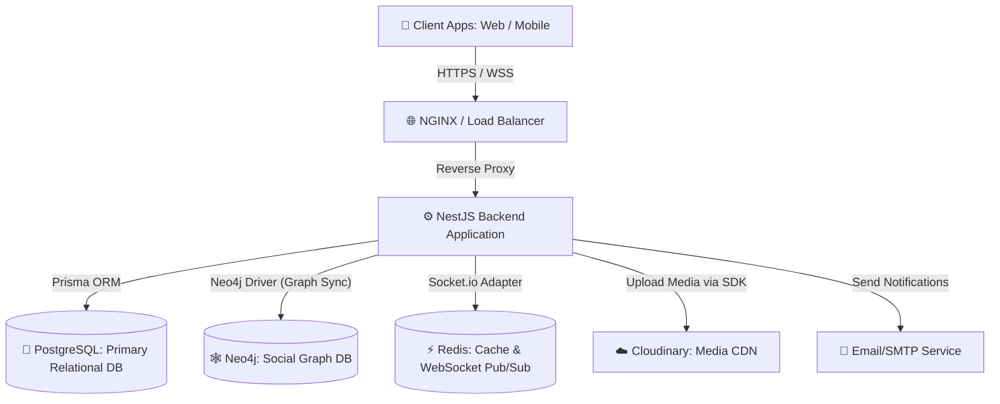
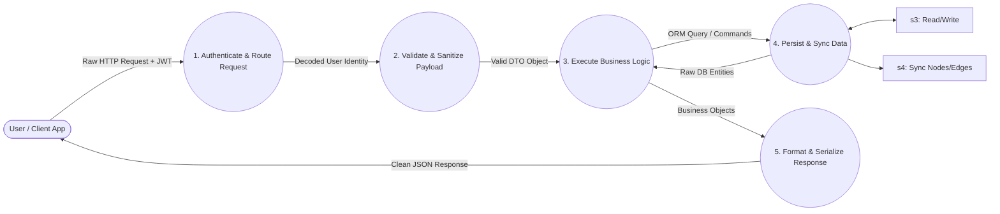
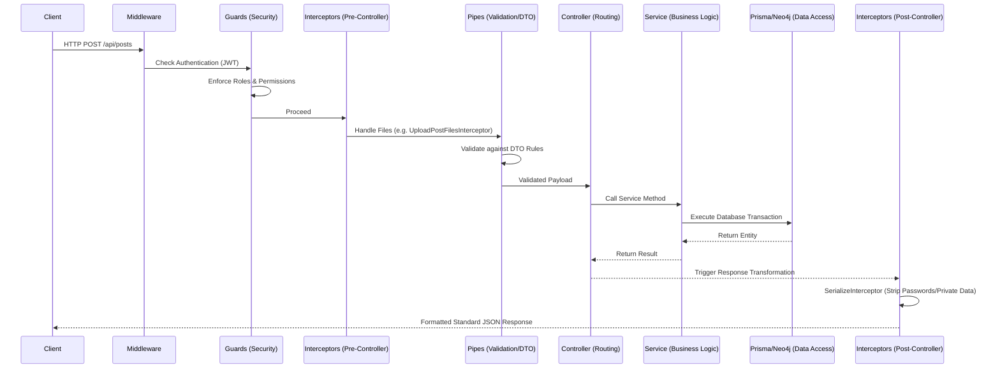

# Ding Platform: System Architecture & Data Flow Documentation
**Prepared for: Graduation Project Documentation**

As a Senior Software Architect, documenting a massive 28-module enterprise-grade backend requires analyzing the system at multiple levels of abstraction. This document provides the high-level **System Architecture**, the **Data Flow Diagrams (DFD)**, and a microscopic breakdown of the **NestJS Request Lifecycle** (Guards, Interceptors, DTOs, Controllers, and Services) to illustrate exactly how every single line of data flows through the application.

---

## 1. High-Level System Architecture (C4 Model Context)

The backend is built on a modern **Node.js/NestJS** micro-architecture, utilizing a dual-database approach (PostgreSQL for relational integrity and Neo4j for the social graph), with external cloud services for media processing.

---

## 2. Data Flow Diagram (DFD)

Data Flow Diagrams map the flow of information for any given process. Below is the **Level 1 DFD** for the core user request flow inside the platform.

### DFD Level 1: Core Platform Request Flow

---

## 3. The NestJS Request Lifecycle (Microscopic Deep-Dive)

In a highly scalable NestJS application, a request does not jump straight to the controller. It passes through a strict, secure pipeline. Here is the architectural lifecycle of every HTTP and WebSocket request in the Ding Platform, line-by-line, layer-by-layer:

### 3.1. Middlewares (Global Setup)
Before anything else, middlewares handle basic framework setups.
- **`chat.middleware.ts`**: Specifically parses and validates WebSocket handshake connections before establishing the persistent TCP link for real-time messaging.

### 3.2. Guards (The Bouncers)
Guards determine **if** a request is allowed to proceed based on credentials, roles, or complex logic.
- **`jwt.guard.ts` / `ws-jwt.guard.ts`**: Extracts the Bearer token, verifies it against the secret, and attaches the user payload to the request (`req.user`). Drops unauthorized requests instantly.
- **`profile-permission.guard.ts`**: Inspects the `ProfilePrivacy` table. If User A tries to view User B's posts, the guard evaluates if `postsVisibility == 'FRIENDS'` and queries Neo4j/Postgres to verify the friendship.
- **`room-member.guard.ts`**: Security for direct messaging. Ensures the requester actually belongs to the `RoomId` they are trying to access.
- **`seller.guard.ts`**: Protects Marketplace endpoints. Blocks users who do not have an approved `SellerProfile`.

### 3.3. Pipes & DTOs (The Sanitizers)
Data Transfer Objects (DTOs) heavily utilize `class-validator` and `class-transformer`.
- **Purpose**: They define the exact shape of incoming JSON bodies.
- **Function**: The global ValidationPipe ensures that if an endpoint expects an email string and an age number, providing an invalid email or a string for age will immediately throw a 400 Bad Request exception before the controller ever sees the data.

### 3.4. Interceptors (The Mutators)
Interceptors wrap the execution stream, allowing you to run code *before* and *after* the controller handles the request.
- **`upload-post-files.interceptor.ts`**: Intercepts multipart/form-data. It grabs images, triggers the upload to Cloudinary, and modifies the request body to inject the newly generated CDN URLs so the controller never has to deal with raw file buffers.
- **`file-cleanup.interceptor.ts`**: Exception handling. If the service throws an error (e.g., database failure) *after* files were uploaded to the cloud, this interceptor catches the exception, deletes the orphaned files from Cloudinary, and rethrows the error to the user.
- **`serialize.interceptor.ts`**: Executes *after* the controller finishes. It strips away internal database fields (like passwords, `isDeleted` flags, or internal IDs) before sending the JSON to the client.
- **`response.interceptor.ts`**: Wraps every output in a standardized envelope: `{ statusCode: 200, data: { ... }, timestamp: "..." }`.

### 3.5. Controllers (The Traffic Directors)
Controllers are kept extremely lean. Their only job is to:
1. Define HTTP Verbs (`@Get()`, `@Post()`) and REST paths.
2. Extract data from the request (`@Body()`, `@Param()`, `@User()`).
3. Pass the data directly into the injected Service layer.

### 3.6. Services (The Brains)
This is where the complex business logic resides. Services manage transactions, invoke helper functions, and coordinate between databases.
- Example (`social.service.ts`): To accept a friend request, the service:
  1. Validates the request exists in Postgres.
  2. Updates the `Friendship` status to ACCEPTED.
  3. Uses the Neo4j Driver to run the Cypher Query: `MERGE (u1)-[:FRIENDS]->(u2)`.
  4. Triggers the Notification Module to send a push notification.

### 3.7. Repositories / Data Access (Prisma & Neo4j)
- **Prisma Client**: Used for strongly-typed relational queries, foreign key enforcement, and handling vast amounts of structured data (Products, Messages, Logs).
- **Neo4j Cypher Execution**: Used via `session.run()` to execute graph algorithms (e.g., shortest path, friend recommendations, and interaction affinity scoring).

---

## 4. Module Dependency Map

The 28 modules are wired together using NestJS Dependency Injection. Common architectural connections include:

- **AuthModule** injects `UserService` and `ProfileService` to create related records upon registration.
- **PostModule** injects `GraphSyncProcessor` to keep Neo4j updated when posts are created, and `FeedModule` reads from that graph.
- **ChatModule** connects to `NotificationModule` to push offline notifications via APN/FCM when a WebSocket message is unread.
- **MarketplaceModule** connects to `AuthModule` (via `seller.guard.ts`) and relies on `TransactionService` for Escrow states.
- **NoroModule (AI)** listens to events from `SentimentModule`, which continuously processes text input from the `Comment` and `Post` modules to track `UserMoodProfile`.

*This strict, highly decoupled modular architecture ensures that scaling the chat infrastructure does not require scaling or redeploying the marketplace infrastructure, paving the way for a smooth transition from a monolithic architecture to microservices in the future.*
