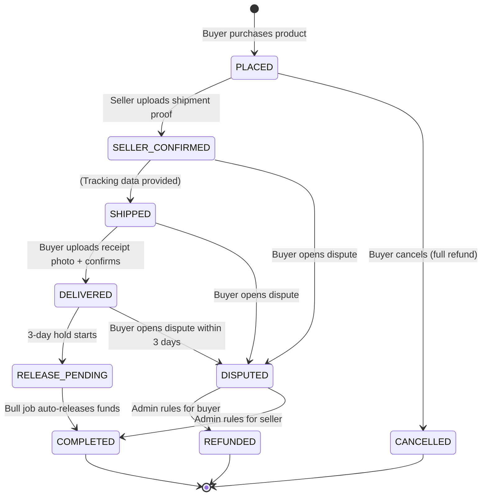

# Escrow Order System — Full Implementation Plan

This system introduces a **secure escrow workflow** for the Ding marketplace. Money is held in escrow after purchase and only released to the seller after the buyer confirms delivery. The seller must provide shipment proof before funds become non-refundable.

## How It Works (Lifecycle)



> [!IMPORTANT]
> The existing `Transaction` model and `TransactionStatus` enum are too simple for this flow. We need a new `Order` model with a richer lifecycle, and evolve the `Transaction` to be purely a **payment ledger entry** linked to the order.

---

## User Review Required

> [!WARNING]
> **Breaking change to `buyProduct` flow**: Currently `buyProduct` creates a `Transaction` and marks the product sold. The new system will instead create an `Order` (status `PLACED`) with an `EscrowPayment` record. The `Transaction` model remains for payment audit but its `status` field will be decoupled from the order lifecycle. Existing PENDING transactions in production (if any) should be migrated.

> [!IMPORTANT]
> **3-day release window**: After buyer confirms delivery, the money is held for **3 calendar days** before auto-release. During this window, the buyer can still open a dispute. Is 3 days acceptable, or do you want a configurable duration?

---

## Open Questions

1. **Refund mechanism**: Since this is a platform with no real payment gateway (yet), should we track escrow as a simple `escrowAmount` field on the order, or do you want a full `Wallet/Balance` system per user?
2. **Dispute flow**: Should admins be the only ones who can resolve disputes, or should there be an auto-resolution after X days of no response?
3. **Partial refunds**: Should we support partial refunds (e.g., damaged item but buyer keeps it), or only full refund vs. full release?

---

## Proposed Changes

### Prisma Schema

#### [MODIFY] [schema.prisma](file:///home/zack-river/Documents/Projects/InProgress/Graduation/Ding-Platform-Backend/prisma/schema.prisma)

**1. New `OrderStatus` enum** (replaces `TransactionStatus` for the order lifecycle):

```prisma
enum OrderStatus {
  PLACED              // Buyer purchased, money escrowed
  SELLER_CONFIRMED    // Seller uploaded shipment proof
  SHIPPED             // In transit (tracking provided)
  DELIVERED           // Buyer confirmed receipt with photo
  RELEASE_PENDING     // 3-day hold before auto-release
  COMPLETED           // Money released to seller
  CANCELLED           // Buyer cancelled before shipment
  DISPUTED            // Buyer opened a dispute
  REFUNDED            // Dispute resolved — buyer refunded
}
```

**2. New `Order` model**:

```prisma
model Order {
  id              String      @id @default(uuid())
  orderNumber     String      @unique  // Human-readable: ORD-XXXXXXXX
  status          OrderStatus @default(PLACED)

  // Parties
  buyerId         String
  buyer           User        @relation("BuyerOrders", fields: [buyerId], references: [id])
  sellerId        String
  seller          User        @relation("SellerOrders", fields: [sellerId], references: [id])

  // Product snapshot (frozen at purchase time)
  productId       String
  product         Product     @relation(fields: [productId], references: [id])
  quantity        Int         @default(1)
  unitPrice       Float
  currency        String      @default("USD")
  totalAmount     Float

  // Escrow
  escrowAmount    Float                // Amount held in escrow
  escrowStatus    EscrowStatus @default(HELD)  // HELD | RELEASED | REFUNDED

  // Seller shipment proof
  shipmentTrackingNumber  String?
  shipmentCarrier         String?
  shipmentProofImageUrl   String?      // Cloudinary URL — photo of packaged order
  shippedAt               DateTime?

  // Buyer delivery confirmation
  deliveryProofImageUrl   String?      // Cloudinary URL — photo of received order
  deliveredAt             DateTime?
  buyerConfirmedAt        DateTime?

  // Release scheduling
  releaseScheduledAt      DateTime?    // deliveredAt + 3 days
  releasedAt              DateTime?    // When money was actually released

  // Dispute
  disputeReason           String?      @db.Text
  disputeOpenedAt         DateTime?
  disputeResolvedAt       DateTime?
  disputeResolution       String?      @db.Text
  disputeResolvedById     String?

  // Cancellation
  cancelledAt             DateTime?
  cancelReason            String?      @db.Text

  createdAt       DateTime    @default(now())
  updatedAt       DateTime    @updatedAt

  @@index([buyerId, status])
  @@index([sellerId, status])
  @@index([status, releaseScheduledAt])
  @@index([orderNumber])
  @@index([productId])
}
```

**3. New `EscrowStatus` enum**:

```prisma
enum EscrowStatus {
  HELD
  RELEASED
  REFUNDED
}
```

**4. Add new `DealLogAction` values**:

```prisma
// Extend existing enum with:
CONFIRM_SHIPMENT
CONFIRM_DELIVERY
RELEASE_FUNDS
OPEN_DISPUTE
RESOLVE_DISPUTE
AUTO_RELEASE_FUNDS
```

**5. Add User relations for orders**:

```prisma
// In the User model, add:
buyerOrders        Order[]       @relation("BuyerOrders")
sellerOrders       Order[]       @relation("SellerOrders")
```

**6. Add Product relation**:

```prisma
// In the Product model, add:
orders             Order[]
```

---

### Order Module (New)

All new files under `src/modules/marketplace/order/`.

#### [NEW] [order.controller.ts](file:///home/zack-river/Documents/Projects/InProgress/Graduation/Ding-Platform-Backend/src/modules/marketplace/order/order.controller.ts)

**Buyer endpoints:**

| Method | Route | Description |
|--------|-------|-------------|
| `GET` | `/marketplace/orders` | List buyer's orders (paginated) |
| `GET` | `/marketplace/orders/:id` | Get order detail |
| `POST` | `/marketplace/orders/:id/confirm-delivery` | Upload receipt photo + confirm delivery |
| `POST` | `/marketplace/orders/:id/cancel` | Cancel order (only if `PLACED`) |
| `POST` | `/marketplace/orders/:id/dispute` | Open dispute (before `COMPLETED`) |

**Seller endpoints** (inside existing `seller.controller.ts`):

| Method | Route | Description |
|--------|-------|-------------|
| `GET` | `/marketplace/seller/orders` | List seller's incoming orders |
| `GET` | `/marketplace/seller/orders/:id` | Get order detail for seller |
| `POST` | `/marketplace/seller/orders/:id/confirm-shipment` | Upload shipment proof + tracking data |

**Admin endpoints** (inside existing `admin-marketplace.controller.ts`):

| Method | Route | Description |
|--------|-------|-------------|
| `GET` | `/marketplace/admin/orders` | List all orders (filterable) |
| `GET` | `/marketplace/admin/orders/:id` | Full order detail |
| `POST` | `/marketplace/admin/orders/:id/resolve-dispute` | Resolve dispute (refund or release) |
| `POST` | `/marketplace/admin/orders/:id/force-release` | Force-release escrowed funds |
| `POST` | `/marketplace/admin/orders/:id/force-refund` | Force-refund to buyer |

#### [NEW] [order.service.ts](file:///home/zack-river/Documents/Projects/InProgress/Graduation/Ding-Platform-Backend/src/modules/marketplace/order/order.service.ts)

Core business logic:

- **`createOrder(buyerId, productId)`** — Called from the refactored `buyProduct`. Atomically: validates stock, decrements quantity, creates `Order` with `PLACED` status, creates escrow record with `HELD` status.
- **`confirmShipment(sellerId, orderId, dto, files)`** — Validates seller ownership. Uploads shipment proof image to Cloudinary. Updates order to `SHIPPED` with tracking info.
- **`confirmDelivery(buyerId, orderId, files)`** — Validates buyer ownership. Uploads delivery proof photo to Cloudinary. Updates order to `DELIVERED`, sets `buyerConfirmedAt`, computes `releaseScheduledAt = now + 3 days`, then enqueues a **delayed Bull job** to auto-release funds.
- **`cancelOrder(buyerId, orderId)`** — Only allowed when `status === 'PLACED'`. Restores product stock. Sets escrow to `REFUNDED`.
- **`openDispute(buyerId, orderId, reason)`** — Allowed when status is `SELLER_CONFIRMED`, `SHIPPED`, `DELIVERED`, or `RELEASE_PENDING`. Pauses the release timer by removing the Bull job.
- **`resolveDispute(adminId, orderId, resolution)`** — Admin resolves: either refund buyer or release to seller.

#### [NEW] [order-release.processor.ts](file:///home/zack-river/Documents/Projects/InProgress/Graduation/Ding-Platform-Backend/src/modules/marketplace/order/order-release.processor.ts)

Bull queue processor (`@Processor('order-release')`):

- **`@Process('release-funds')`** — Delayed job (3 days). Checks that the order is still in `RELEASE_PENDING` status (not disputed). If clear, updates escrow to `RELEASED`, order to `COMPLETED`, creates audit log.

#### [NEW] [order.dto.ts](file:///home/zack-river/Documents/Projects/InProgress/Graduation/Ding-Platform-Backend/src/modules/marketplace/dtos/order.dto.ts)

DTOs:

```
ConfirmShipmentDto     → shipmentTrackingNumber, shipmentCarrier (+ file upload)
ConfirmDeliveryDto     → (file upload only, no body fields needed)
CancelOrderDto         → cancelReason (optional)
OpenDisputeDto         → disputeReason (required, min 10 chars)
ResolveDisputeDto      → resolution: 'REFUND' | 'RELEASE', adminNote
GetOrdersQueryDto      → status filter, pagination
```

---

### Modify Existing Files

#### [MODIFY] [product.service.ts](file:///home/zack-river/Documents/Projects/InProgress/Graduation/Ding-Platform-Backend/src/modules/marketplace/product/product.service.ts)

- Refactor `buyProduct()` to create an `Order` instead of a raw `Transaction`. The order will be `PLACED` with escrow `HELD`.

#### [MODIFY] [seller.controller.ts](file:///home/zack-river/Documents/Projects/InProgress/Graduation/Ding-Platform-Backend/src/modules/marketplace/seller/seller.controller.ts)

- Add seller order endpoints: `GET /seller/orders`, `GET /seller/orders/:id`, `POST /seller/orders/:id/confirm-shipment`.

#### [MODIFY] [seller.service.ts](file:///home/zack-river/Documents/Projects/InProgress/Graduation/Ding-Platform-Backend/src/modules/marketplace/seller/seller.service.ts)

- Update `getMyActiveDeals` and `getMyDealHistory` to also query `Order` records.
- Add `getMyOrders()`, `getOrderDetail()`, and delegate `confirmShipment` to `OrderService`.

#### [MODIFY] [admin-marketplace.controller.ts](file:///home/zack-river/Documents/Projects/InProgress/Graduation/Ding-Platform-Backend/src/modules/marketplace/admin/admin-marketplace.controller.ts)

- Add admin order management endpoints.

#### [MODIFY] [admin-marketplace.service.ts](file:///home/zack-river/Documents/Projects/InProgress/Graduation/Ding-Platform-Backend/src/modules/marketplace/admin/admin-marketplace.service.ts)

- Add `listOrders()`, `getOrderDetail()`, `resolveDispute()`, `forceRelease()`, `forceRefund()`.

#### [MODIFY] [marketplace.module.ts](file:///home/zack-river/Documents/Projects/InProgress/Graduation/Ding-Platform-Backend/src/modules/marketplace/marketplace.module.ts)

- Import `BullModule.registerQueue({ name: 'order-release' })`.
- Register `OrderController`, `OrderService`, `OrderReleaseProcessor`.

#### [MODIFY] [schema.prisma — DealLogAction enum](file:///home/zack-river/Documents/Projects/InProgress/Graduation/Ding-Platform-Backend/prisma/schema.prisma)

- Add new actions: `CONFIRM_SHIPMENT`, `CONFIRM_DELIVERY`, `RELEASE_FUNDS`, `AUTO_RELEASE_FUNDS`, `OPEN_DISPUTE`, `RESOLVE_DISPUTE`.

---

### Security Considerations

| Threat | Mitigation |
|--------|-----------|
| Buyer confirms delivery of unshipped order | Status machine enforces: `DELIVERED` only reachable from `SHIPPED` |
| Seller never ships | Buyer can cancel (`PLACED` → `CANCELLED`) or open dispute |
| Fake delivery photo | Admin can review dispute evidence; photo stored immutably on Cloudinary |
| Race condition on stock | Atomic `updateMany` with `quantity: { gt: 0 }` inside `$transaction` (already exists) |
| Double-release of funds | Bull job checks `status === 'RELEASE_PENDING'` before releasing; idempotent |
| Dispute after auto-release | Prevented: dispute pauses/cancels the Bull delayed job |
| Unauthorized status transitions | Every endpoint validates: caller ownership + current status |
| File upload abuse | Reuse existing Cloudinary validation: type whitelist (JPEG/PNG/WebP), 10MB limit |

---

### State Machine Rules (Strict)

```
PLACED              → SELLER_CONFIRMED (seller), CANCELLED (buyer)
SELLER_CONFIRMED    → SHIPPED (seller), DISPUTED (buyer)
SHIPPED             → DELIVERED (buyer), DISPUTED (buyer)
DELIVERED           → RELEASE_PENDING (auto), DISPUTED (buyer)
RELEASE_PENDING     → COMPLETED (auto/admin), DISPUTED (buyer)
DISPUTED            → REFUNDED (admin), COMPLETED (admin)
COMPLETED           → (terminal)
CANCELLED           → (terminal)
REFUNDED            → (terminal)
```

---

## Verification Plan

### Automated Tests

1. **Build verification**: `pnpm run build` — confirm zero type errors after all changes.
2. **Schema validation**: `npx prisma validate` — confirm schema is correct.
3. **Migration**: `npx prisma migrate dev --name add-order-escrow` — confirm migration applies cleanly.

### Manual Verification

- Trace through each state transition in the service code to confirm guards prevent invalid transitions.
- Verify Bull delayed job setup matches the `releaseScheduledAt` computation.
- Verify Cloudinary upload reuse for shipment/delivery proof images.
