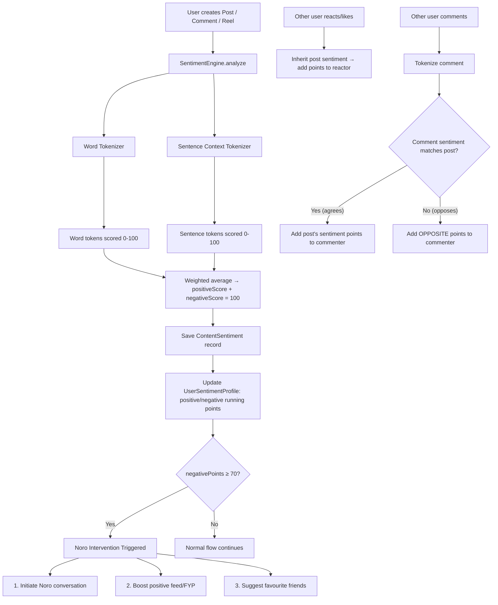

# Sentiment Tokenization & Mood Engine — Full Implementation Plan

A platform-wide system that tokenizes every piece of user-generated content (posts, comments, reels) into word-level and sentence-level sentiment tokens, assigns positive/negative points (0–100 scale, always summing to 100), tracks per-user cumulative mood scores, and triggers Noro AI interventions when negativity reaches a threshold.

## How It Works



---

## User Review Required

> [!IMPORTANT]
> **Performance impact**: Every post/comment creation will now go through sentiment analysis before saving. This is done **asynchronously via a Bull queue** so it won't block the API response. The user sees instant post creation; sentiment scores appear within 1-2 seconds.

> [!WARNING]
> **Existing UserMoodProfile evolution**: The current `UserMoodProfile` uses a decimal `moodScore` on a 1-10 scale (set by Noro conversations only). This plan introduces a **new** `UserSentimentProfile` model with `positivePoints` / `negativePoints` on a 0-100 scale that is updated by ALL platform activity. The existing `UserMoodProfile` will remain for Noro conversation-specific tracking — they serve different purposes.

---

## Open Questions

1. **Sentiment dictionary source**: The current Noro sentiment analysis uses a small hardcoded word list (~12 words). The new system needs a much richer dictionary. Should we:
   - **(A)** Use a bundled static dictionary (~2000 words, zero external dependencies, works offline) — **recommended for graduation project**
   - **(B)** Call Ollama/LLM for sentence-level analysis (richer but requires Ollama running)
   - **(C)** Both: static dictionary for word tokens + Ollama for sentence context tokens

2. **Decay over time**: Should old activity sentiment decay? E.g., a very negative post from 30 days ago should have less weight than one from today. Or should points be permanent?

3. **Noro intervention cooldown**: Once Noro intervenes, how long before it can trigger again? 24 hours? Only after points drop back below threshold?

---

## Proposed Changes

### Prisma Schema

#### [MODIFY] [schema.prisma](file:///home/zack-river/Documents/Projects/InProgress/Graduation/Ding-Platform-Backend/prisma/schema.prisma)

**1. New `ContentSentiment` model** — stores the tokenized sentiment analysis for any piece of content:

```prisma
model ContentSentiment {
  id              String   @id @default(uuid())

  // What content this belongs to (polymorphic)
  contentType     SentimentContentType  // POST, COMMENT, REEL
  contentId       String                // postId, commentId, reelId

  // Who authored it
  userId          String
  user            User     @relation("UserContentSentiments", fields: [userId], references: [id], onDelete: Cascade)

  // Aggregate scores (always sum to 100)
  positiveScore   Int      // 0-100
  negativeScore   Int      // 0-100

  // Token breakdown stored as JSON for analysis/debugging
  wordTokens      Json     // Array<{ word: string, positive: number, negative: number }>
  sentenceTokens  Json     // Array<{ sentence: string, positive: number, negative: number }>

  // Raw text analyzed
  rawText         String   @db.Text

  createdAt       DateTime @default(now())

  @@unique([contentType, contentId])
  @@index([userId, createdAt])
  @@index([contentType, contentId])
}

enum SentimentContentType {
  POST
  COMMENT
  REEL
}
```

**2. New `UserSentimentProfile` model** — cumulative positive/negative points per user:

```prisma
model UserSentimentProfile {
  userId            String   @id
  user              User     @relation(fields: [userId], references: [id], onDelete: Cascade)

  // Running weighted average (0-100 each, always sum to 100)
  positivePoints    Float    @default(50)
  negativePoints    Float    @default(50)

  // Lifetime counters for stats
  totalEventsProcessed  Int      @default(0)

  // Noro intervention tracking
  noroActive            Boolean  @default(false)
  lastInterventionAt    DateTime?
  interventionCount     Int      @default(0)

  // Feed boost flag (set by Noro when negativity high)
  feedBoostPositive     Boolean  @default(false)
  feedBoostUntil        DateTime?

  lastUpdated       DateTime @default(now())

  @@index([negativePoints])
  @@index([noroActive])
}
```

**3. New `SentimentEvent` model** — audit trail of every sentiment impact on a user:

```prisma
model SentimentEvent {
  id              String              @id @default(uuid())
  userId          String              // User whose points changed
  user            User                @relation("UserSentimentEvents", fields: [userId], references: [id], onDelete: Cascade)

  eventType       SentimentEventType  // AUTHORED_POST, AUTHORED_COMMENT, LIKED_POST, etc.
  sourceContentId String?             // The post/comment/reel that caused this
  sourceUserId    String?             // The original author (if reaction)

  // Points applied (positive delta)
  positiveImpact  Float
  negativeImpact  Float

  // Resulting user points after this event
  resultPositive  Float
  resultNegative  Float

  createdAt       DateTime @default(now())

  @@index([userId, createdAt])
  @@index([eventType, createdAt])
}

enum SentimentEventType {
  AUTHORED_POST
  AUTHORED_COMMENT
  AUTHORED_REEL
  LIKED_POST
  LIKED_REEL
  COMMENTED_ON_POST
  VIEWED_REEL
  REACTED_TO_COMMENT
}
```

**4. New `NoroIntervention` model** — tracks when Noro activates and what method it used:

```prisma
enum InterventionMethod {
  CONVERSATION        // Noro initiates a talk
  FEED_BOOST          // Boost positive content in feed/FYP
  FRIEND_SUGGESTION   // Suggest favourite friends to talk to
}

model NoroIntervention {
  id              String              @id @default(uuid())
  userId          String
  user            User                @relation("NoroInterventions", fields: [userId], references: [id], onDelete: Cascade)
  method          InterventionMethod
  triggerScore    Float               // negativePoints at trigger time
  resolved        Boolean             @default(false)
  resolvedAt      DateTime?

  // If method = CONVERSATION → link to the conversation
  conversationId  String?

  // If method = FRIEND_SUGGESTION → suggested friend IDs
  suggestedFriendIds String[]  @default([])

  createdAt       DateTime @default(now())

  @@index([userId, createdAt])
  @@index([resolved])
}
```

**5. Add User relations**:

```prisma
// In the User model, add:
contentSentiments    ContentSentiment[]   @relation("UserContentSentiments")
sentimentProfile     UserSentimentProfile?
sentimentEvents      SentimentEvent[]     @relation("UserSentimentEvents")
noroInterventions    NoroIntervention[]   @relation("NoroInterventions")
```

---

### Sentiment Engine (New Module)

All new files under `src/modules/sentiment/`.

#### [NEW] [sentiment.module.ts](file:///home/zack-river/Documents/Projects/InProgress/Graduation/Ding-Platform-Backend/src/modules/sentiment/sentiment.module.ts)

Registers Bull queue `sentiment-analysis`, imports `DatabaseModule`, `NoroModule`. Exports `SentimentService` for use by Post, Comment, Reels, Like modules.

#### [NEW] [sentiment.service.ts](file:///home/zack-river/Documents/Projects/InProgress/Graduation/Ding-Platform-Backend/src/modules/sentiment/sentiment.service.ts)

Core engine with these methods:

| Method | Purpose |
|--------|---------|
| `analyzeContent(text, contentType, contentId, userId)` | Tokenizes text → word tokens + sentence tokens → computes positiveScore/negativeScore (sum=100) → saves `ContentSentiment` → enqueues user update |
| `applyContentSentiment(userId, positive, negative, eventType, sourceId)` | Updates `UserSentimentProfile` using **exponential moving average** (new event = 20% weight, history = 80% weight) → saves `SentimentEvent` → checks threshold |
| `applyReactionSentiment(reactorUserId, contentId, contentType, eventType)` | Looks up the content's sentiment → applies those points to the reactor's profile |
| `applyCommentInteraction(commenterId, postId, commentText)` | Analyzes comment → compares sentiment to post → if same direction: apply post's sentiment; if opposite: apply **flipped** sentiment |
| `checkAndTriggerIntervention(userId)` | If `negativePoints >= 70` and no active intervention → triggers Noro |
| `triggerNoroIntervention(userId, negativePoints)` | Picks intervention method based on score severity and triggers it |

#### [NEW] [sentiment-analysis.processor.ts](file:///home/zack-river/Documents/Projects/InProgress/Graduation/Ding-Platform-Backend/src/modules/sentiment/sentiment-analysis.processor.ts)

Bull processor (`@Processor('sentiment-analysis')`):

- **`@Process('analyze-content')`** — Receives `{ text, contentType, contentId, userId }` → calls `SentimentService.analyzeContent()`
- **`@Process('apply-reaction')`** — Receives `{ reactorUserId, contentId, contentType, eventType }` → calls `SentimentService.applyReactionSentiment()`
- **`@Process('analyze-comment')`** — Receives `{ commenterId, postId, commentText, commentId }` → calls `SentimentService.applyCommentInteraction()`

#### [NEW] [tokenizer.ts](file:///home/zack-river/Documents/Projects/InProgress/Graduation/Ding-Platform-Backend/src/modules/sentiment/tokenizer.ts)

Pure utility functions (no DI dependencies):

```typescript
/**
 * Word Tokenizer:
 * - Splits text into individual words
 * - Strips punctuation, normalizes case
 * - Looks up each word in the sentiment dictionary
 * - Returns Array<{ word, positive, negative }> where positive+negative=100
 * - Unknown/neutral words get { positive: 50, negative: 50 }
 */
export function tokenizeWords(text: string): WordToken[];

/**
 * Sentence Context Tokenizer:
 * - Splits text into sentences (by . ! ? or newline)
 * - Evaluates each sentence holistically:
 *   - Negation detection ("not happy" → flips sentiment)
 *   - Intensifier detection ("very sad" → amplifies)
 *   - Sarcasm markers ("oh great" after negative context)
 * - Returns Array<{ sentence, positive, negative }> where positive+negative=100
 */
export function tokenizeSentences(text: string): SentenceToken[];

/**
 * Combines word and sentence tokens into final score:
 * - Word tokens weight: 40%
 * - Sentence tokens weight: 60% (context-aware = more accurate)
 * - Returns { positiveScore, negativeScore } summing to 100
 */
export function computeAggregateScore(
  wordTokens: WordToken[],
  sentenceTokens: SentenceToken[]
): { positiveScore: number; negativeScore: number };
```

#### [NEW] [sentiment-dictionary.ts](file:///home/zack-river/Documents/Projects/InProgress/Graduation/Ding-Platform-Backend/src/modules/sentiment/sentiment-dictionary.ts)

Comprehensive word-to-sentiment mapping (~2000 entries):

```typescript
// Each word maps to a positivity score from 0-100
// Score > 50 = positive tendency, < 50 = negative tendency
export const SENTIMENT_DICTIONARY: Record<string, number> = {
  // Strong positive (80-100)
  'amazing': 95, 'wonderful': 93, 'excellent': 92, 'love': 90,
  'fantastic': 90, 'beautiful': 88, 'happy': 85, 'great': 83,
  'awesome': 88, 'joy': 90, 'excited': 85, 'grateful': 87,
  
  // Mild positive (60-79)
  'good': 70, 'nice': 68, 'fine': 62, 'ok': 55, 'thanks': 72,
  'better': 73, 'enjoy': 75, 'fun': 78, 'smile': 80,
  
  // Neutral (45-55)
  'the': 50, 'and': 50, 'is': 50, 'was': 50,
  
  // Mild negative (21-44)
  'bad': 25, 'boring': 30, 'tired': 35, 'annoyed': 28,
  'worried': 32, 'stressed': 27, 'upset': 22,
  
  // Strong negative (0-20)
  'terrible': 8, 'awful': 5, 'depressed': 7, 'hopeless': 3,
  'miserable': 5, 'suicidal': 1, 'hate': 8, 'angry': 12,
  'devastated': 6, 'anxious': 18, 'lonely': 15, 'alone': 20,
  // ... ~2000 total entries
};

export const NEGATION_WORDS = ['not', "n't", 'no', 'never', 'neither', 'nobody', 'nothing', 'nowhere', 'hardly', 'barely'];
export const INTENSIFIERS = ['very', 'extremely', 'incredibly', 'absolutely', 'really', 'so', 'super', 'totally'];
```

---

### Hook Into Existing Modules

#### [MODIFY] [post.service.ts](file:///home/zack-river/Documents/Projects/InProgress/Graduation/Ding-Platform-Backend/src/modules/post/post.service.ts)

In `createPost()` — after post is created, enqueue sentiment analysis:

```typescript
// After line ~213 (after graph sync enqueue)
await this.sentimentQueue.add('analyze-content', {
  text: data.content,
  contentType: 'POST',
  contentId: newPost.id,
  userId: data.authorId,
});
```

In `createComment()` — after comment is created, enqueue comment sentiment analysis:

```typescript
// After line ~655 (after graph sync enqueue)
await this.sentimentQueue.add('analyze-comment', {
  commenterId: userId,
  postId: postId,
  commentText: dto.content,
  commentId: comment.id,
});
```

In `toggleLike()` — when a like is added, enqueue reaction sentiment:

```typescript
// After line ~535 (after like is created)
await this.sentimentQueue.add('apply-reaction', {
  reactorUserId: userId,
  contentId: postId,
  contentType: 'POST',
  eventType: 'LIKED_POST',
});
```

#### [MODIFY] [post.module.ts](file:///home/zack-river/Documents/Projects/InProgress/Graduation/Ding-Platform-Backend/src/modules/post/post.module.ts)

- Import `BullModule.registerQueue({ name: 'sentiment-analysis' })`.

#### [MODIFY] [reels.service.ts](file:///home/zack-river/Documents/Projects/InProgress/Graduation/Ding-Platform-Backend/src/modules/reels/reels.service.ts)

In `finalizeReel()` — after reel is ready, analyze caption:

```typescript
await this.sentimentQueue.add('analyze-content', {
  text: payload.caption || '',
  contentType: 'REEL',
  contentId: reelId,
  userId: userId,
});
```

In `recordView()` — viewing a reel inherits its sentiment:

```typescript
if (payload.viewerId) {
  await this.sentimentQueue.add('apply-reaction', {
    reactorUserId: payload.viewerId,
    contentId: reelId,
    contentType: 'REEL',
    eventType: 'VIEWED_REEL',
  });
}
```

In `toggleLike()` — liking a reel applies its sentiment:

```typescript
await this.sentimentQueue.add('apply-reaction', {
  reactorUserId: userId,
  contentId: reelId,
  contentType: 'REEL',
  eventType: 'LIKED_REEL',
});
```

In `addComment()` — commenting on a reel:

```typescript
await this.sentimentQueue.add('analyze-comment', {
  commenterId: userId,
  postId: reelId, // reused field — represents the parent content
  commentText: payload.content,
  commentId: comment.id,
});
```

#### [MODIFY] [reels.module.ts](file:///home/zack-river/Documents/Projects/InProgress/Graduation/Ding-Platform-Backend/src/modules/reels/reels.module.ts)

- Import `BullModule.registerQueue({ name: 'sentiment-analysis' })`.

#### [MODIFY] [feed.service.ts](file:///home/zack-river/Documents/Projects/InProgress/Graduation/Ding-Platform-Backend/src/modules/feed/feed.service.ts)

Modify `getFeed()` and the reels `getFeed()` to check `UserSentimentProfile.feedBoostPositive`:

```typescript
// If user has feedBoostPositive = true, add a filter/boost:
// - Prefer posts from the ContentSentiment table with positiveScore > 65
// - De-rank posts with negativeScore > 65
// - Inject positive content from explore feed
```

This integrates with the existing Neo4j scoring as an additional `moodBoost` factor.

---

### Noro AI Integration

#### [MODIFY] [noro.service.ts](file:///home/zack-river/Documents/Projects/InProgress/Graduation/Ding-Platform-Backend/src/modules/noro/noro.service.ts)

Add new method `handleSentimentIntervention(userId, negativePoints)`:

```typescript
async handleSentimentIntervention(userId: string, negativePoints: number) {
  // 1. Determine intervention method based on severity
  let method: InterventionMethod;
  if (negativePoints >= 85) {
    method = 'CONVERSATION';  // Direct Noro talk — most urgent
  } else if (negativePoints >= 78) {
    method = 'FRIEND_SUGGESTION'; // Suggest close friends to talk to
  } else {
    method = 'FEED_BOOST'; // Boost positive content — least intrusive
  }

  // 2. Execute intervention
  switch (method) {
    case 'CONVERSATION':
      // Auto-create a Noro conversation with PERIODIC_CHECKIN trigger
      const conv = await this.createConversation(userId, 'PERIODIC_CHECKIN');
      // Auto-send empathetic opening message
      await this.addMessage({
        conversationId: conv.id,
        userId,
        role: 'ASSISTANT',
        content: "Hey, I noticed you might be going through a tough time. I'm here if you want to talk. How are you feeling? 💙",
      });
      break;

    case 'FRIEND_SUGGESTION':
      // Query Neo4j for top 3 friends with highest affinity score
      // Return their IDs for client to display as suggestion cards
      break;

    case 'FEED_BOOST':
      // Set feedBoostPositive = true on UserSentimentProfile
      // Set feedBoostUntil = now + 48 hours
      break;
  }

  // 3. Record the intervention
  await this.prisma.noroIntervention.create({ ... });
}
```

#### [MODIFY] [noro.module.ts](file:///home/zack-river/Documents/Projects/InProgress/Graduation/Ding-Platform-Backend/src/modules/noro/noro.module.ts)

- Export `NoroService` so `SentimentModule` can import it.

---

### Sentiment Score Computation Rules

| Rule | Detail |
|------|--------|
| **Sum constraint** | `positiveScore + negativeScore = 100` always |
| **Word token scoring** | Each word looked up in dictionary → score 0-100. Unknown words = 50 (neutral). |
| **Sentence context** | Sentence score considers: negation ("not happy" → flip), intensifiers ("very sad" → amplify by 1.5x), emoji detection (😊 → +15, 😢 → -15) |
| **Aggregate formula** | `final = 0.4 * avgWordScore + 0.6 * avgSentenceScore` |
| **User point update** | Exponential moving average: `newPoints = 0.2 * eventScore + 0.8 * currentPoints` |
| **Reaction weight** | Liking/viewing a post applies **50%** of that post's sentiment (weaker than authoring) |
| **Comment agreement** | If comment sentiment direction matches post → inherit post sentiment; if opposite → apply **inverted** sentiment (to penalize negativity in positive spaces and vice versa) |
| **View weight** | Viewing a reel applies only **25%** of its sentiment (passive consumption = less weight) |

---

### Security & Edge Cases

| Concern | Mitigation |
|---------|-----------|
| Performance — analyzing every post | Bull queue = **fully async**, never blocks API response. Posts are created instantly. |
| Gaming — spamming positive posts | Exponential moving average caps influence of any single event at 20% |
| Empty content | Skip analysis if text is empty or whitespace-only |
| Very short content (1-2 words) | Word tokens only (sentence analysis needs ≥1 sentence) |
| Rapid fire events | Bull queue deduplicates by `contentType+contentId` (unique constraint on `ContentSentiment`) |
| Noro spam | Cooldown: minimum 24h between interventions per user |
| Feed boost expiry | `feedBoostUntil` field — feed service checks this and ignores boost if expired |
| Sentiment data privacy | `ContentSentiment` and `SentimentEvent` are internal — never exposed to public API |

---

### New Files Summary

| File | Purpose |
|------|---------|
| `src/modules/sentiment/sentiment.module.ts` | Module registration with Bull queue |
| `src/modules/sentiment/sentiment.service.ts` | Core analysis + user point update + Noro trigger |
| `src/modules/sentiment/sentiment-analysis.processor.ts` | Bull queue processor |
| `src/modules/sentiment/tokenizer.ts` | Word and sentence tokenization logic |
| `src/modules/sentiment/sentiment-dictionary.ts` | 2000-word sentiment dictionary |
| `src/modules/sentiment/sentiment.constants.ts` | Thresholds, weights, cooldowns |
| `src/modules/marketplace/dtos/order.dto.ts` | *(from previous plan — kept)* |

### Modified Files Summary

| File | Change |
|------|--------|
| `prisma/schema.prisma` | Add 4 new models, 3 new enums, User relations |
| `src/modules/post/post.service.ts` | Enqueue sentiment jobs on create, comment, like |
| `src/modules/post/post.module.ts` | Register `sentiment-analysis` queue |
| `src/modules/reels/reels.service.ts` | Enqueue sentiment jobs on finalize, view, like, comment |
| `src/modules/reels/reels.module.ts` | Register `sentiment-analysis` queue |
| `src/modules/feed/feed.service.ts` | Check `feedBoostPositive` flag to boost positive content |
| `src/modules/noro/noro.service.ts` | Add `handleSentimentIntervention()` method |
| `src/modules/noro/noro.module.ts` | Export `NoroService` |
| `src/app.module.ts` | Import `SentimentModule` |

---

## Verification Plan

### Automated Tests

1. **Unit tests for tokenizer**: Test word tokenization, negation detection, intensifier handling, aggregate score computation.
2. **Unit tests for score constraint**: Every test case must assert `positive + negative === 100`.
3. **Build verification**: `pnpm run build` — zero type errors.
4. **Schema validation**: `npx prisma validate` — schema is correct.
5. **Migration**: `npx prisma migrate dev --name add-sentiment-engine` — migration applies cleanly.

### Manual Verification

- Create a post with clearly positive text → verify `ContentSentiment` record has `positiveScore > 70`.
- Create a post with clearly negative text → verify `negativeScore > 70`.
- Like a negative post → verify reactor's `negativePoints` increase.
- Push a user's `negativePoints` above 70 → verify `NoroIntervention` record is created.
- Verify feed boost flag activates and positive content is prioritized.
